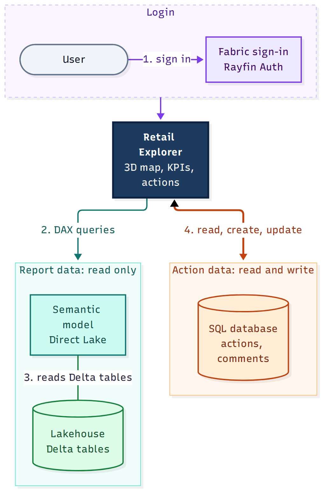
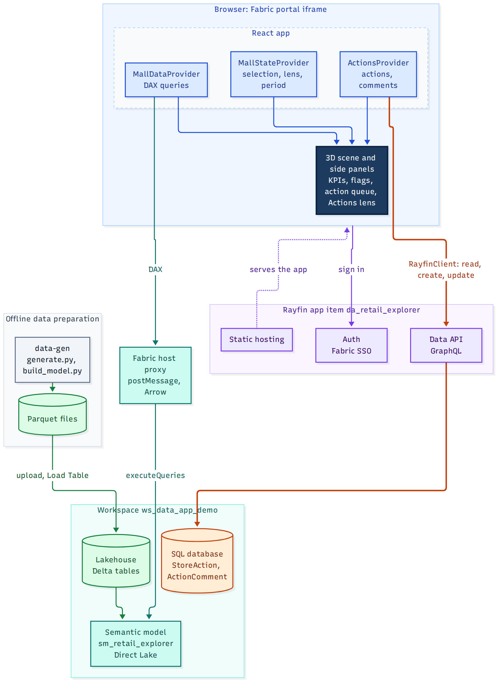

# Architecture

## Data flow

1. `data-gen/generate.py` writes 12 parquet files (`data-gen/out/`, git-ignored).
2. The files are uploaded to the Lakehouse `Files/retail_explorer/` folder in OneLake and converted to Delta tables with the Lakehouse Load Table API.
3. `data-gen/build_model.py` generates a TMDL definition (`model/sm_retail_explorer.SemanticModel/`) and a create payload. `data-gen/deploy_model.py` pushes it to Fabric and refreshes it.
4. The app registers the model as the `retailExplorer` connection (`fabric.yaml`, generated into `src/fabric.generated.ts`) and runs DAX through `useSemanticModelQuery`.
5. In the Fabric portal the app runs in an iframe. Queries go to the host with postMessage (`EmbedFabricApiProxy`) and come back as Arrow. The app therefore needs the Fabric host to run; a bare `localhost` tab has no data connection.
6. User-created data (actions and comments) takes a second path: the typed `RayfinClient` calls the Rayfin data API (GraphQL) of the app item, which stores it in a SQL database. The semantic model is never written to.

## Architecture diagram

### Simplified view



Users sign in through Fabric (Rayfin Auth) and reach the app. Report data flows one way: Lakehouse tables feed the semantic model, and the app reads it with DAX. Action data flows both ways between the app and its SQL database. The app never writes to the semantic model.

### Detailed view



The diagram sources are [architecture-simple.mmd](architecture-simple.mmd) and [architecture.mmd](architecture.mmd) (Mermaid). After editing one, regenerate its image:

```bash
npx --yes @mermaid-js/mermaid-cli -i docs/architecture.mmd -o docs/architecture.png -b white -s 2
npx --yes @mermaid-js/mermaid-cli -i docs/architecture-simple.mmd -o docs/architecture-simple.png -b white -s 2
```

## Repository layout

| Path | Purpose |
|---|---|
| `data-gen/` | `geometry.py` (schematic floor layouts), `generate.py` (simulation and parquet output), `build_model.py` (TMDL), `deploy_model.py` (push and refresh) |
| `model/` | Generated TMDL for the semantic model; `create-body.json` is git-ignored |
| `rayfin/` | `rayfin.yml` (auth, data, static hosting), `data/` (entities `StoreAction` and `ActionComment`, registered in `data/schema.ts`), `tsconfig.json` used by the Rayfin CLI to compile the entities |
| `src/queries/` | One folder per page area (`shell`, `portfolio`, `center`, `floorplan`, `store`). Each query is a `.dax` file plus a `.ts` factory, and a `.json` Vega-Lite spec when it feeds a chart |
| `src/lib/` | Pure logic: lenses, color scales, periods, formatting, geometry, mall model, insights, actions, typed Rayfin client |
| `src/hooks/` | `mall-state` (selection reducer and context), `use-mall-data` (data provider), `use-query-rows`, `use-actions` (actions provider and comment thread hook) |
| `src/components/scene/` | 3D scene (react-three-fiber) and the 2D fallback |
| `src/components/panels/` | Side panels: portfolio, center, floor, store, plus `store-actions` and `action-queue` |
| `src/components/` | Header, lens panel, query-backed chart and grid wrappers, loading/error states |
| `docs/` | This documentation |

## App architecture

`App` wraps `MallStateProvider` (selection state), `MallDataProvider` (queries) and `ActionsProvider` (actions). `Shell` lays out the scene on the left and a details panel on the right, and picks the panel from the selection: store, floor, center or portfolio.

### Selection state

`MallState` holds `propertyKey`, `floorKey`, `unitKey`, `lensId` and `periodId`. Selecting a shallower level clears deeper ones; `back` pops one level; `focusUnit` sets the center, level and store at once (used by the action queue). This single state drives both the 3D camera and the side panel.

### Data loading (`use-mall-data`)

- Static geometry, loaded once: `properties`, `floors`, `shapes`, `units`, plus `data-bounds` (first and last sales date).
- Period dependent: `unit-kpis` (one row per unit with every lens value), `property-kpis`, `portfolio-kpis`.
- Geometry and KPIs are kept apart. Changing the period replaces only the KPI map, so meshes keep their geometry, and changing the lens needs no new query because `unit-kpis` already carries all lens values.
- Query results are cached by the Fabric SDK. Panels run their own chart queries and the SDK cache absorbs repeats.

### App-owned data

Actions live in `ActionsProvider` (`hooks/use-actions.tsx`), separate from the semantic-model data.

- `lib/rayfin-client.ts` builds one `RayfinClient<DataAppSchema>` from `VITE_RAYFIN_API_URL` and `VITE_RAYFIN_PUBLISHABLE_KEY`; the schema type comes from `rayfin/data/schema.ts`. The auth service uses the same client.
- The provider loads all actions once (paged with `executePaginated`, 100 per page), exposes them by unit and as a status map for the Actions lens, and reloads the list after every create or update. A comment thread loads on demand through `useActionComments` while it is open.
- Load and write errors are kept in state and shown in the action UI only; the rest of the app keeps working without the backend.
- Writes require a signed-in session. The author id and email come from `client.auth.getSession()`.
- Both entities carry `@authenticated('*')`: every signed-in user can read and write all rows. The join key to the semantic model is `Unit Key` (stored as `unitKey`), with `propertyKey` for navigation.
- Pure helpers in `lib/actions.ts` (types, labels, draft from a flag, queue ordering, overdue check, per-unit map status) are unit tested.

### Query design

- DAX computes and filters; TypeScript formats and shapes. Date ranges and ids are substituted into `__TOKEN__` placeholders with `fill()` (`src/queries/helpers.ts`).
- Each factory returns `{ connection, query, columnMetadata }`, plus `vegaLiteSpec` for chart queries. `columnMetadata` is keyed by the raw DAX column name (`Unit[Unit Key]`, `[Sales]`) and maps to a Vega-safe alias.
- `lib/table-rows.ts` turns a result into objects keyed by those aliases for non-chart use.
- Each chart factory can be validated with `npm run validate:visual -- <factory.ts> '<params json>'`. Non-chart queries are checked with `npx fabric-app-data query retailExplorer -f <file>`.

## 3D scene

Built with `@react-three/fiber` and `@react-three/drei` (`CameraControls`, `Html`). Loaded lazily so the first paint stays light.

| File | Role |
|---|---|
| `mall-scene.tsx` | Canvas, lights, hover tooltip, click handling per mode, property labels |
| `scene-layout.ts` | Pure layout math: mode, property x, floor gap, floor target (y, opacity, interactive), camera pose |
| `floor-group.tsx` | One level: slab, units, store-name labels; animates its height |
| `unit-mesh.tsx` | Extruded unit polygon; animates height, opacity and color; edge lines; pointer events |
| `slab.tsx` | Floor slab with atrium cut-outs; ghost floors (offices, parking) |
| `camera-rig.tsx` | Fly-to between portfolio, center and floor poses; fits the viewport aspect |
| `plan-2d.tsx` | SVG plan used when WebGL is unavailable |
| `scene-env.ts` | Palette hook (reads CSS tokens, reacts to theme change), WebGL and reduced-motion checks |

Scene modes come from the selection:

- **portfolio**: three stacks side by side, compressed floor gap, property labels.
- **center**: the chosen stack fills the view, floors spread out, other centers fade out.
- **floor**: camera tilts over the chosen level, floors above lift away and hide, floors below dim, store names appear.

Details worth knowing:

- Rendering uses `frameloop="demand"`. Every animated component invalidates the frame until its values settle.
- Polygons are stored as `x,y x,y ...` text in `Unit` and `Floor Shape`, in a 1000x600 plan space. They are scaled by 0.01 into scene units and extruded; the extrusion height is animated through `scale.z`.
- Colors are read from CSS custom properties at runtime (`readPalette`), so the scene follows the light/dark theme without hardcoded values.
- `drei` `Html` labels stay mounted and are hidden with CSS. Unmounting them throws a `removeChild` error under React 19.
- Lighting intensities (ambient 1.7, directional 1.7) are set so top faces match the palette colors; `Canvas` uses `flat` (no tone mapping).
- Vacant units are low, translucent and use the `--color-vacant` token.
